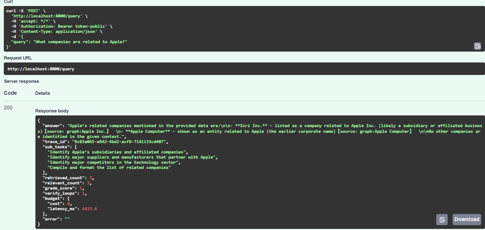
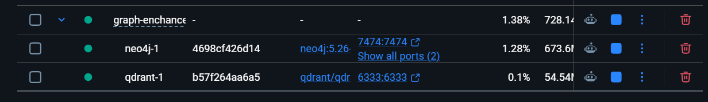
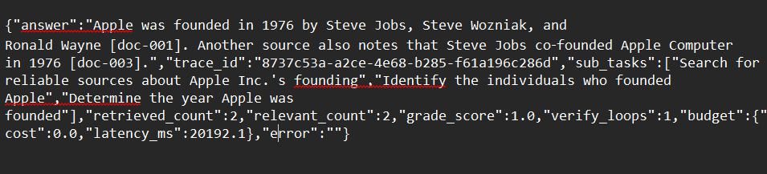
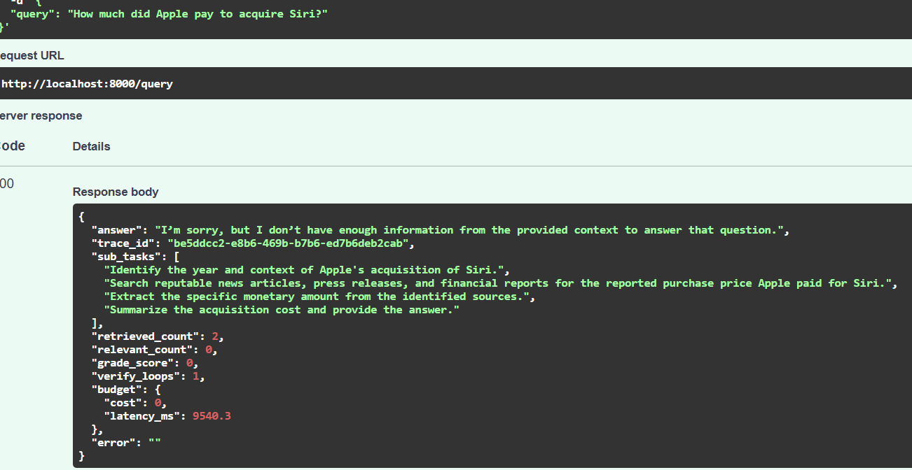
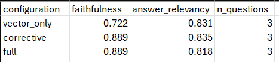

# Agentic, Graph-Enhanced RAG


An agentic RAG API built with LangGraph. The system can:

- Decompose multi-hop questions
- Route queries to vector search, Neo4j, SQL, or web search
- Grade retrieval quality and rewrite queries
- Enforce per-document ACLs during retrieval
- Detect prompt injection
- Track cost and latency budgets
- Run locally with Docker
- Evaluate multiple RAG configurations

## Quick Start

### 1. Configure environment variables

```bash
cp .env.example .env

Add your credentials to .env:

GROQ_API_KEY=your-groq-api-key
TAVILY_API_KEY=your-tavily-api-key

2. Start the services
docker compose up -d --build

3. Seed the databases
python -m src.ingestion.seed_data
This seeds Qdrant and Neo4j with the sample data.


4. Create the Python environment
py -3.12 -m venv .venv
.\.venv\Scripts\python -m pip install --upgrade pip
.\.venv\Scripts\python -m pip install -r requirements.txt
.\.venv\Scripts\python -m pip install -r requirements-eval.txt

5. Query the API
curl -X POST http://localhost:8000/query \
  -H "Authorization: Bearer token-public" \
  -H "Content-Type: application/json" \
  -d '{"query":"Who founded Apple?"}'












below was output when i logged in as an employee so confidential info is shared with certain auth role only


Full agent is ~1.6× slower and ~2.5× more expensive per query than vector-only but ~20 pp more faithful

