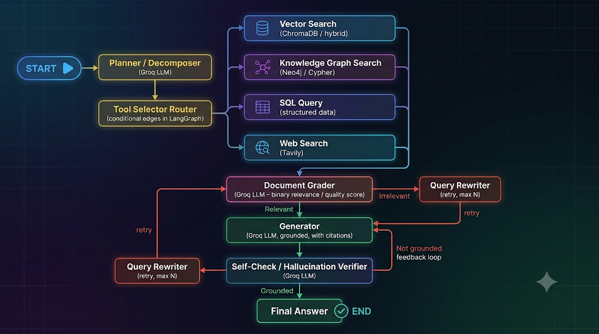
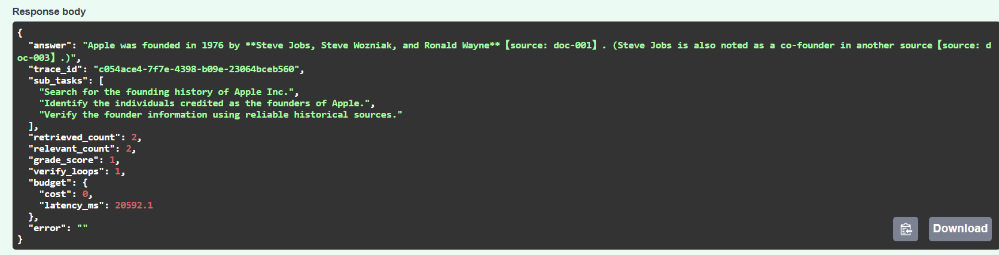
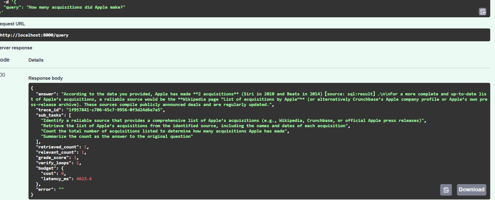
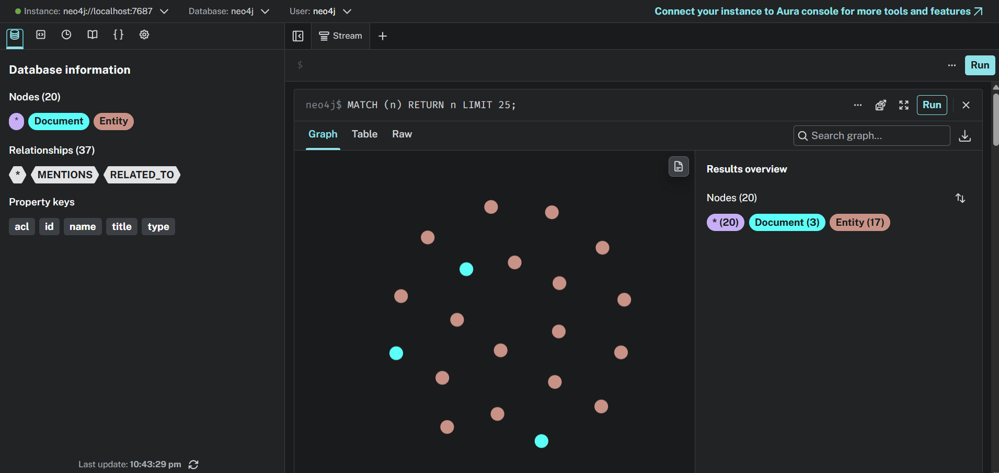
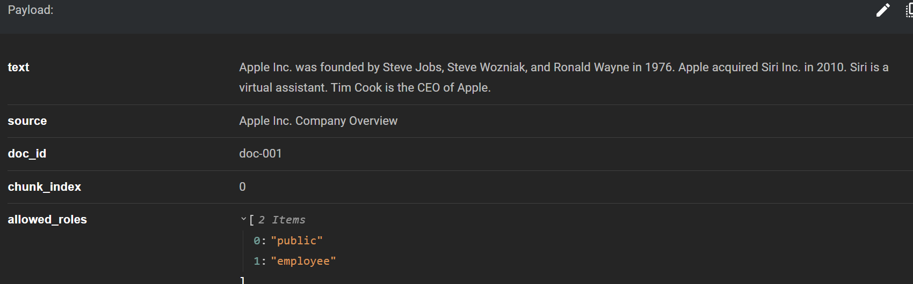
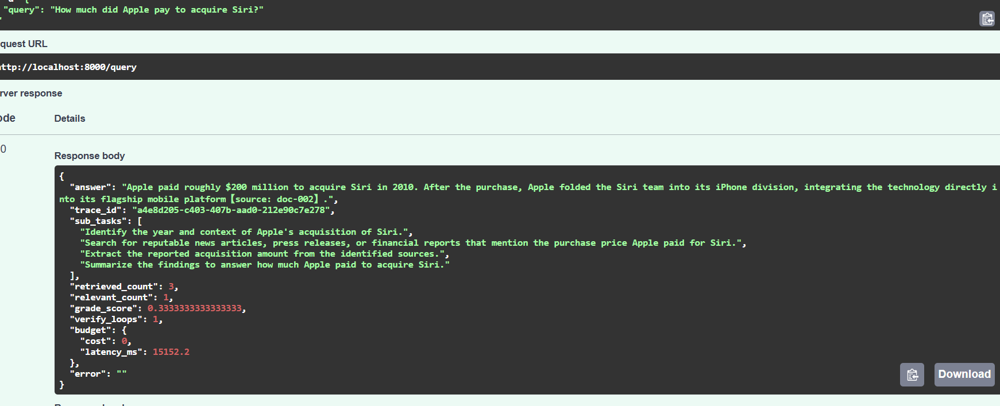

# Agentic, Graph-Enhanced RAG

An API where a LangGraph agent decomposes multi-hop questions, routes to **vector search**, a **Neo4j knowledge graph**, **SQL**, or the **web**, grades retrieval quality, rewrites queries, and retries. It enforces **per-document ACLs at retrieval time**, screens for **prompt injection**, tracks **cost and latency budgets**, and ships with **Docker deployment** and an **eval harness**.

## Quick Start

```bash
cp .env.example .env   # add GROQ_API_KEY and TAVILY_API_KEY
docker compose up -d --build
python -m src.ingestion.seed_data   # seed Qdrant + Neo4j
curl -X POST http://localhost:8000/query \
  -H "Authorization: Bearer token-public" \
  -H "Content-Type: application/json" \
  -d '{"query":"Who founded Apple?"}'

py -3.12 -m venv .venv
.\.venv\Scripts\python -m pip install --upgrade pip
.\.venv\Scripts\python -m pip install -r requirements.txt
.\.venv\Scripts\python -m pip install -r requirements-eval.txt













below was output when i logged in as an employee so confidential info is shared with certain auth role only



Full agent is ~1.6× slower and ~2.5× more expensive per query than vector-only but ~20 pp more faithful

